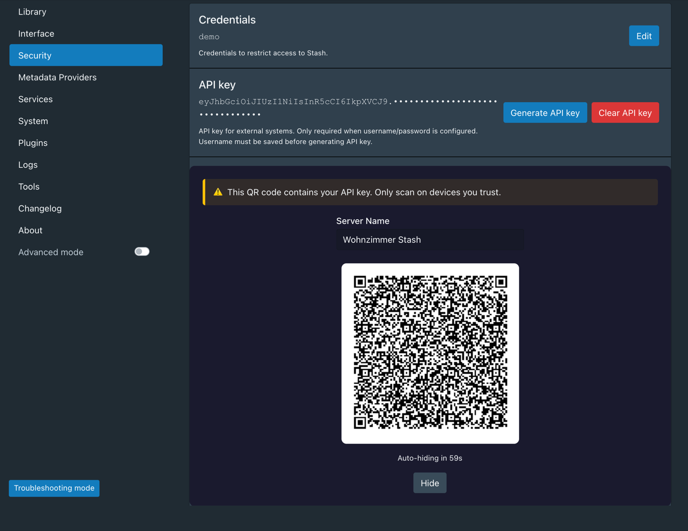
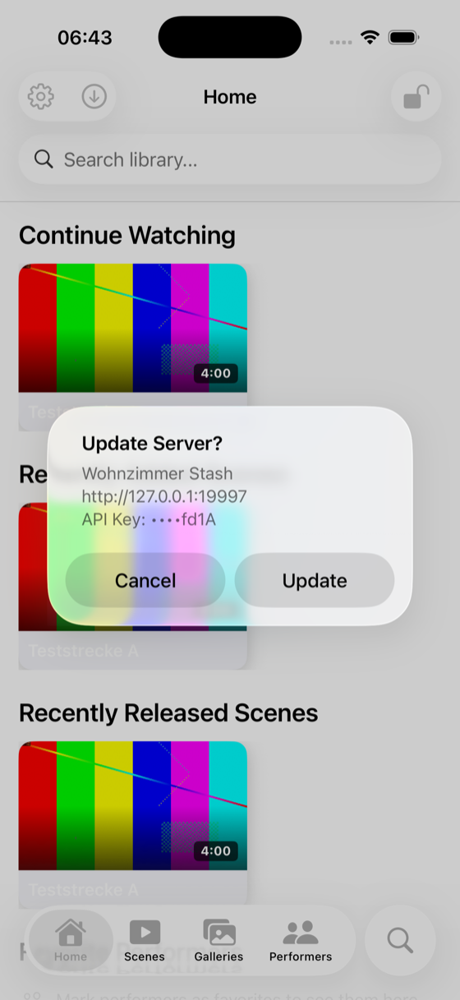
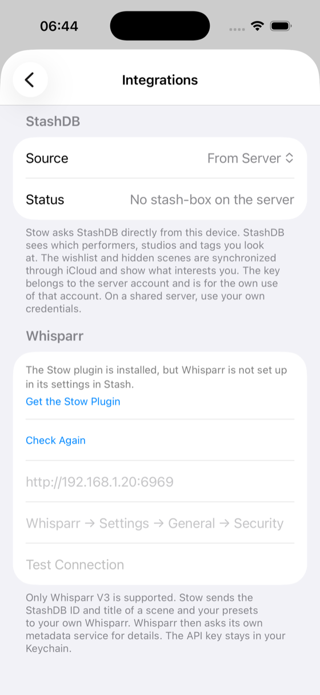
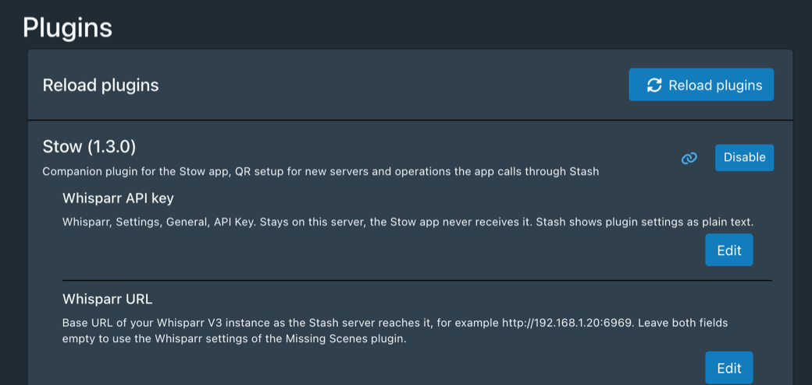

<div align="center">


# Stow for Stash

**The companion plugin that connects your Stash server to the Stow app**

Scan a QR code to add your server in seconds. Reach Whisparr through Stash without handing the app another key.

[](plugins/stow/stow.yml)
[](LICENSE)
[](https://stashapp.cc)
[](plugins/stow/stow.py)
[](https://stow.rocks)

</div>

---

Stow is a multi-platform Apple client for [Stash](https://stashapp.cc). This plugin runs on your Stash server and gives the app two things it cannot get from Stash alone: a one-step server setup, and a safe route to your Whisparr instance.

## Features

|                          |                                                                                                                                       |
| ------------------------ | ------------------------------------------------------------------------------------------------------------------------------------- |
| 📱 **QR setup**          | A button on **Settings → Security** shows a QR code with server name, address and API key. Scan it and Stow offers to add the server. |
| 🔗 **Whisparr bridge**   | Stow talks to Whisparr V3 through Stash. The Whisparr key stays on the server, and Whisparr only has to be reachable from Stash.      |
| 🧩 **One plugin**        | Everything ships as the single plugin `stow`, installed from the Stow plugin source in one click.                                     |
| 🔒 **Careful by design** | The QR hides itself after 60 seconds, and the Whisparr bridge forwards only the few requests the app makes.                           |
| 🪶 **No dependencies**   | The server side is plain Python 3 with the standard library. Nothing to install next to it.                                           |

## Screenshots

<div align="center">



_The QR code on Stash's Security page._

&nbsp;&nbsp;&nbsp;

_Stow asks before it adds the scanned server (left) and recognises the plugin in its Whisparr settings (right)._



_The plugin and its Whisparr settings in Stash._

</div>

## Installation

You need a running [Stash](https://stashapp.cc) server (0.31 or newer) and Python 3 on the machine that runs it. The official Stash Docker image already has Python 3.

### 1. Add the plugin source

1. Open Stash and go to **Settings → Plugins**.
2. Under **Available Plugins**, click **Add Source**.
3. Enter the URL `https://plugins.stow.rocks/index.yml`, and a name such as `Stow`, and confirm the dialog.
4. Reload the source so that Stash reads its list.

### 2. Install the plugin

1. In the list of available plugins, open the **Stow** source and tick **Stow**.
2. Click **Install**.
3. Check that **Stow** appears under **Plugins** further down the same page.

### 3. Connect the Stow app

1. Make sure your Stash server has a username and password under **Settings → Security → Authentication**, then **Generate API key**. Stash only shows a key when authentication is set up.
2. Click **📱 Stow QR** next to the **Generate API key** button.
3. Give the server a name. It is the name the app will show.
4. Scan the QR code with the camera of your iPhone or iPad. The link opens Stow.
5. Stow asks whether to add the server. Confirm, and your library starts to sync.

The QR code contains your API key. Scan it only on devices you trust. It disappears by itself after 60 seconds.

### 4. Optional: Whisparr through Stash

1. In Stash, open **Settings → Plugins → Stow**.
2. Fill in **Whisparr URL** (as the Stash server reaches it, for example `http://192.168.1.20:6969`) and **Whisparr API key**. Leave both empty to reuse the Whisparr settings of the Missing Scenes plugin.
3. In the settings of Stow, open **Integrations** and tap **Check Again**.

Stow then uses the plugin automatically and falls back to a direct Whisparr connection when the plugin is not available. Only Whisparr V3 is supported.

### Manual installation

If you cannot use the plugin source, copy the plugin by hand:

```bash
git clone https://github.com/StowRocks/StashPlugins.git
cp -R StashPlugins/plugins/stow /path/to/stash/plugins/stow
```

Then click **Reload plugins** under **Settings → Plugins**. The folder must contain `stow.yml`, `stow.py`, `whisparr.py`, `stow-server-qr.js` and `stow-server-qr.css`.

## Troubleshooting

| Problem                                              | What to check                                                                                                             |
| ---------------------------------------------------- | ------------------------------------------------------------------------------------------------------------------------- |
| No **📱 Stow QR** button                             | The plugin is not installed or not reloaded, or you are not on **Settings → Security**. Reload the page after installing. |
| "Generate an API key before creating a Stow QR code" | Set a username and password first. Stash only creates an API key when authentication is on.                               |
| Stow says the plugin is not found or too old         | Update the plugin to 1.2.0 or newer, then tap **Check Again** in the app.                                                 |
| Stow says Whisparr is not set up in the plugin       | Fill in **Whisparr URL** and **Whisparr API key** in the plugin settings, or in the Missing Scenes plugin.                |
| Stow cannot reach Whisparr through the plugin        | Whisparr must be reachable from the Stash server, not from your phone. Test the address from the Stash host.              |

## How it works

The QR code holds a `stow://add-server` link whose `data` parameter is the Base64-encoded server name, address and API key. The plugin reads the key from the rendered Security page and never touches Stash's configuration file.

The app calls the server-side part through the GraphQL mutation `runPluginOperation`. There is one entry point, `stow.py`, and the operation is chosen with `args.op`: `status` reports the plugin version and capabilities, `whisparr` forwards one request to Whisparr. The details are in the [plugin documentation](plugins/stow/README.md).

Stash shows plugin settings as plain text, so anyone who can open the Stash settings can read the Whisparr key. Treat the settings page like the keys it shows.

## Development

Use Node.js 26 (see `.nvmrc`) and Python 3.

```bash
pnpm install --frozen-lockfile   # dependencies
pnpm build                       # build the plugin into _site/
pnpm test                        # JavaScript and Python tests
pnpm lint                        # ESLint
pnpm format:check                # Prettier
```

When you change `version` in `stow.yml`, change `VERSION` in `stow.py` too. A test checks that they match.

## Related projects

- [Stow](https://stow.rocks), the Apple client this plugin is made for.
- [Stash](https://stashapp.cc), the media organiser behind it all.

## License

[GPL-3.0-only](LICENSE). Every source file carries an `SPDX-License-Identifier` header.
